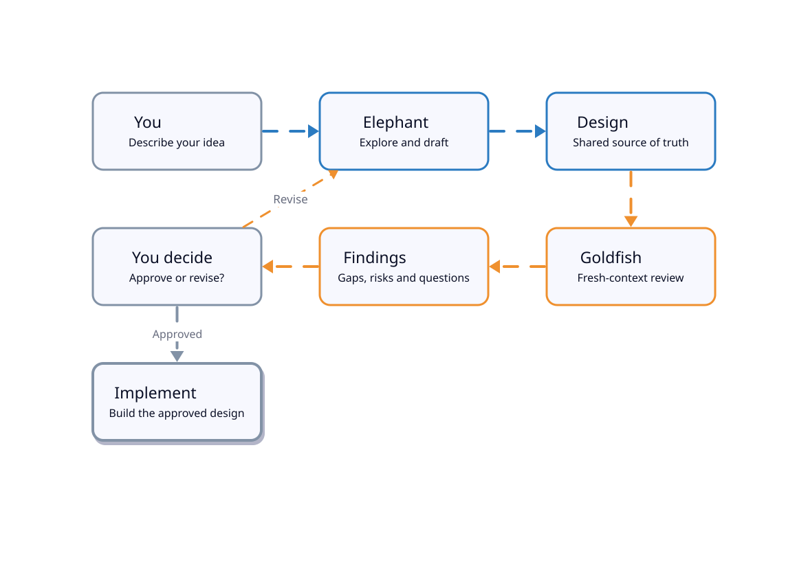

<p align="center">
  
</p>

<h1 align="center">🐘 dsh-egm 🐟</h1>

<p align="center">English &ensp;·&ensp; <a href="README.zh-CN.md">简体中文</a></p>

<p align="center"><strong>Design with an elephant. Review with a goldfish.</strong></p>

<p align="center">
  <a href="#install">Install</a> &ensp;·&ensp;
  <a href="#quickstart">Quickstart</a> &ensp;·&ensp;
  <a href="#how-it-works">How it works</a> &ensp;·&ensp;
  <a href="#what-this-plugin-adds">The plugin</a> &ensp;·&ensp;
  <a href="#included-skills">Skills</a> &ensp;·&ensp;
  <a href="#example-run">Example run</a> &ensp;·&ensp;
  <a href="#feedback-and-support">Feedback</a>
</p>

<p align="center">
  <a href="LICENSE"></a>
  <a href="https://github.com/dryw/dsh-egm/actions/workflows/ci.yml"></a>
  <a href="https://dsh-plugin.org/plugins/dryw/dsh-egm"></a>
  <a href="https://www.npmjs.com/package/dsh-egm"></a>
  
</p>

<p align="center"><sub>Google's Elephant-Goldfish Model, adapted for DeepSeek Harness.</sub></p>

## Meet the Elephant 🐘

The Elephant is your long-running design partner.

It explores your project, reads the relevant code, asks questions, and helps you work through alternatives. It keeps track of the decisions you've made and the reasons behind them. Together, you develop a design document.

But the Elephant has a problem. **It remembers too much.**

After hours of discussion, it understands what you meant, even when you haven't written it down. Ask the Elephant whether the design makes sense, and it might unconsciously fill in the gaps from your earlier conversation.

That's dangerous, because whoever implements the design next won't necessarily have that context.

We need someone who doesn't remember.

## Meet the Goldfish 🐟

The Goldfish starts fresh.

It hasn't participated in your design discussions. It doesn't know why you chose a particular architecture or which requirements you explained but forgot to write down. It receives a self-contained review prompt, the design, and the reference material it needs. It can read and search permitted project files, **but it doesn't inherit the Elephant's conversation**.

Then it tries to understand what you've written.

Can it figure out how the system is supposed to work? Are the requirements unambiguous? Are failure cases accounted for? Do the interfaces fit together? And, most importantly, **could someone build this correctly without having been part of the original conversation?**

When the Goldfish discovers a problem, the Elephant helps you address it. You revise the document, review it again, and decide when it's ready.

The result isn't just a specification. It's project knowledge that can survive the conversation that created it.

### Why bother?

AI coding assistants have three recurring failure modes:

1. **Forget.** Important decisions disappear when a conversation is compacted or restarted.
2. **Assume.** An assistant confidently implements requirements nobody actually agreed on.
3. **Agree.** An assistant reviewing its own design can quietly carry the same unwritten assumptions into the review.

The [Elephant-Goldfish Model](https://github.com/google/elephant-goldfish-model) (EGM) separates the context-rich design conversation from independent, fresh-context criticism. **`dsh-egm` brings that workflow to [DeepSeek Harness](https://github.com/deepseek-ai/deepseek-harness) as a native plugin.**

It's useful when a feature, migration, or architectural change needs decisions before code. For a small, well-understood bug fix, your normal coding workflow is probably enough.

## Install

You'll need:

- **DeepSeek Harness 0.2.x**, compatible with the package's declared range `>=0.2.1-rc.5 <0.3.0`.
- **Node.js 22 or 24** (`>=22 <25`; CI tests Node 22 and 24). If you're using the DSH 0.2.2 alpha line, its own requirement is Node 24.9 or newer.

Install the plugin into your Harness profile. The example uses `web`; substitute the profile you actually use.

```bash
dsh plugin --profile web add dsh-egm
```

Restart Harness, then check **Settings → Plugins** to confirm it's enabled.

The bundle declares the read-only `egm-reviewer` preset, but it does not create the host's agent-preset service. `egm_reviewer` needs a profile that composes an `agentPresets` registry resolving a valid default preset, plus an in-process `spawn` subagent provider. Harness `web` profiles already compose both. For a profile without a registry (for example `headless`), the package ships an opt-in patch: add `--patch <installed package>/adapters/dsh/agent-presets.patch.yml` when starting the profile. Without a registry `egm_reviewer` fails closed (`the agent-presets service is not composed`); the [host guide](docs/dsh.md#host-prerequisites-and-current-limit) lists the exact refusals and the observed effect of applying the patch to a profile that already has a registry. The package does not compose the registry automatically.

For local development, you can install from a checkout instead:

```bash
dsh plugin --profile web add /path/to/dsh-egm
```

## Quickstart

Copy each slash command below into the **Harness chat**.

Imagine you're adding webhook delivery to an application. Before writing code, you need answers to questions like: What happens if delivery fails? What if the same event arrives twice?

**1. Explore the idea.**

```text
/egm-brainstorm Add webhook delivery to this application.
```

The Elephant helps you explore requirements, alternatives, and trade-offs. The brainstorming workflow can bring in fresh reviewers to challenge the proposal. You and the Elephant settle on a direction and record it in a concept brief.

**2. Draft the design.**

```text
/egm-draft
```

The Elephant develops a specification section by section, asking for your decisions rather than silently filling in the blanks. The working draft is `design_draft.md` in your project working directory (or the EGM artifact directory). When you finalize it, the skill asks where to save and writes the final design as `<FEATURE>.md`; the default directory is `docs/designs/`, for example `docs/designs/webhook-delivery.md`.

**3. Send in the Goldfish.**

```text
/egm-review design_draft.md
```

Fresh-context, read-only reviewers examine the design for ambiguities, missing contracts, failure cases, and implementation risks.

**4. Resolve the findings.**

```text
/egm-resolve
```

Decide which criticisms matter, revise the design, and request another review if needed. You decide when the specification is good enough.

**Then you write the code.** Or, more likely, you let your AI coding assistant write it—this time with a clearer specification of what it's supposed to build.

You can also invoke the skills individually; the full sequence isn't mandatory.

## How it works



*The Elephant remembers. The Goldfish starts fresh. You stay in control.*

The Elephant carries the project conversation forward. The Goldfish reviewers approach the written specification without that conversational history. The human decides what to accept, reject, or investigate.

A structured `/egm-review` uses five stages: **Initial Zoom Out**, **Comprehension**, **Design Critique**, **Intermediate Zoom Out**, and **Implementation Readiness**. Different reviewers look at the design from different angles, and their findings become things you can resolve, not decisions the agents make on your behalf.

For the fuller protocol, including the optional bootstrap step, see the [detailed protocol diagram](docs/assets/protocol.svg).

### What this plugin adds

Google's upstream project supplies the EGM skills, reviewer personas, and design standards. This package supplies the DeepSeek Harness integration needed to run that workflow:

- **Seven native skills.** Invoke `/egm-brainstorm`, `/egm-draft`, `/egm-review`, and the other EGM commands directly in Harness.
- **Fresh reviewer sessions.** The `egm_reviewer` tool starts a new child using the `egm-reviewer` preset and a self-contained prompt. It does not fork or inherit the Elephant's session transcript.
- **Host-enforced, read-only review.** The reviewer preset has file-reading and search tools, not file-writing, command-execution, session-reading, user-question, or delegation tools. The plugin also restricts tool visibility and guards calls against its reviewer allowlist. This is enforced through the Harness tool system, not merely by asking the model to behave.
- **Traceable upstream content.** The EGM skills, personas, and standards are shipped unchanged from a pinned upstream commit. Harness-specific instructions are injected when the skills register, rather than edited into those upstream files.

**What “read-only” does and doesn't mean:** it prevents Goldfish reviewers from using write, shell, and other disallowed tools in the supported Harness configuration. It doesn't mean reviewers are unable to see project files: they can read and search material available to their permitted tools. Don't treat the reviewer preset as a confidentiality boundary, and check what project material you expose to it.

The package declares `>=0.2.1-rc.5 <0.3.0`; native replay evidence covers the pinned 0.2.1-rc.5 runtime on Linux, rather than every version in that range. Isolation behavior depends on the Harness implementation of tool restrictions and child-agent spawning APIs. The [host guide](docs/dsh.md) describes the enforcement layers, dispatch rules and their limits, and explains what comes from Google and what this package adds; the [testing record](TESTING.md) lists the tests and current results.

## Upstream tracking and adapter versions

`dsh-egm` is independently versioned. It preserves EGM skills, personas, and standards from the exact Git revision in [upstream.lock.json](upstream.lock.json), with recorded content hashes. DSH behavior lives in the adapter layer; no canonical skill text is forked.

We monitor upstream releases and material changes, prefer tagged revisions when practical, and may adopt a tested interim commit. Each update requires content checks and a documented runtime assessment; advancing the pin does not carry forward live acceptance. Adapter fixes and DSH compatibility changes follow this package's semantic versioning, independently of upstream EGM releases.

[TESTING.md](TESTING.md) separates content checks, keyless replay, and live-model runs. Live-model acceptance of the next release is pending, and Agent Team compatibility is not tested. Recognized upstream support is an EGM maintainer decision, tracked in [EGM #240](https://github.com/google/elephant-goldfish-model/issues/240).

## Included skills

| Skill | Invoke | Use it to… |
|---|---|---|
| Brainstorm | `/egm-brainstorm` | Explore a proposal, challenge assumptions, and produce a concept brief. |
| Draft | `/egm-draft` | Turn a brief or existing notes into a design document. |
| Review | `/egm-review` | Review a design with fresh Goldfish agents across five stages. |
| Resolve | `/egm-resolve` | Triage findings and agree on changes to the design. |
| Review loop | `/egm-review-loop` | Run a configured set of reviewers for a specific review task. |
| Bootstrap | `/egm-bootstrap` | Build README and codebase context for an existing project. |
| Drift report | `/egm-drift-report` | Compare checked-in design documents with the current source. |

All seven skills are **user-invoked**. The plugin doesn't start an expensive design or review process on its own, and it doesn't automatically start implementing a reviewed design.

### Where do the documents go?

EGM works with ordinary Markdown files. A typical project might keep specifications here:

```text
my-project/
├── AGENTS.md
└── docs/
    └── designs/
        └── webhook-delivery.md
```

Your artifact locations depend on the skill and project setup. To direct EGM's working artifacts to a separate directory, add this to your project's `AGENTS.md`:

```text
EGM artifact directory: .dev/docs
```

You can add that working directory to `.gitignore` while keeping finalized design documents under version control. That makes decisions, reviews, and implementation plans inspectable long after the original chat has ended.

## Example run

Want to see whether the reviewers actually find something useful?

The recorded end-to-end example (historical `0.2.0`) used a small inventory application; its artifacts include a concept brief, a design document, and review reports from all five stages.

In one review, a Goldfish caught an important missing interface: the proposed inventory sweep needed a lock to cover a sequence of operations, but the design never specified a safe way for the sweep to acquire that lock. The revised design introduced a locked snapshot context manager rather than reaching into the inventory store's private lock. The finding and its resolution are part of the recorded example.

The run also shows the limits of the evidence: it used synthetic owner answers, auto-approved some draft gates, and split the review across supported presets; its final implementation-readiness re-audit returned **NO-GO** at the re-audit cap, with the remaining precision issues recorded and addressed afterward. It demonstrates the design workflow and its ability to surface concrete problems, **not** that the fixture feature was implemented or that the resulting design passed every gate. The example is historical `0.2.0` evidence.

The original example files are in earlier Git revisions; they aren't included in the npm package.

## Feedback and support

Trying `dsh-egm` for the first time? Your experience is useful whether it worked or not.

- **Installation failed or something broke?** [Report a bug](https://github.com/dryw/dsh-egm/issues/new?template=bug_report.yml). Include the command, what happened, and your DSH and Node versions if known.
- **Have an improvement or documentation suggestion?** [Request a feature](https://github.com/dryw/dsh-egm/issues/new?template=feature_request.yml).
- **Want to describe your first run or ask a question?** [Open an issue](https://github.com/dryw/dsh-egm/issues/new/choose).

I'm especially interested in whether the plugin installed cleanly, whether the Goldfish reviewers started as expected, and whether their criticism changed your design.

**Before sharing logs or examples:** remove API keys, credentials, personal information, and confidential project material. A small redacted reproduction is better than a full private transcript.

## For maintainers and curious readers

- [docs/dsh.md](docs/dsh.md) — the host guide: install/invoke, manifest changes, path roots, dispatch and stage sequencing, reviewer isolation and refusals.
- [TESTING.md](TESTING.md) — the requirement map, harness test record and current limits.
- [CHANGELOG.md](CHANGELOG.md) — release history.
- [docs/assets/](docs/assets/README.md) — the workflow diagrams, their D2 sources and the renderer.

To run the package checks from a checkout:

```bash
npm test
node adapters/dsh/check_upstream.mjs
```

The upstream drift check reports changes; it never modifies or replaces the vendored files.

## License and attribution

Licensed under the [Apache License, Version 2.0](LICENSE).

The skills, reviewer personas, standards, and templates are vendored from [google/elephant-goldfish-model](https://github.com/google/elephant-goldfish-model), Copyright Google LLC, under Apache-2.0. See [NOTICE](NOTICE) and [docs/dsh.md](docs/dsh.md). The DeepSeek Harness adapter, plugin bundle, and reviewer preset are original work in this package.

`dsh-egm` is an independent community port. It is not affiliated with, endorsed by, or officially supported by Google.
