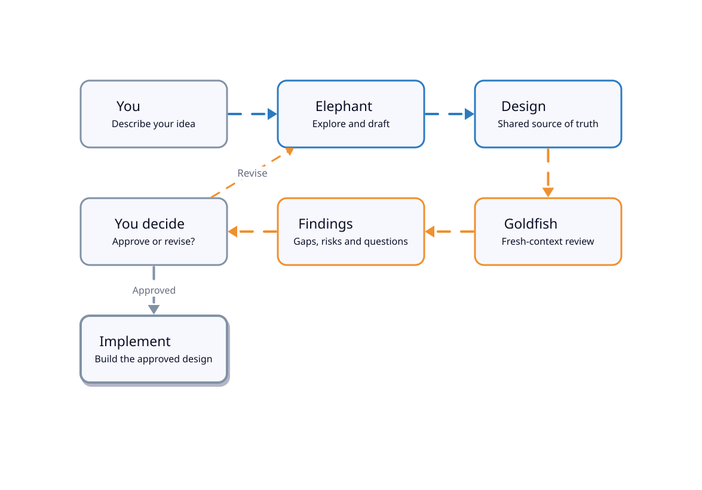

<p align="center">
  
</p>

<h1 align="center">dsh-egm</h1>

<p align="center">English &ensp;·&ensp; <a href="README.zh-CN.md">简体中文</a></p>

<p align="center"><strong>Design with an elephant. Review with a goldfish.</strong></p>

<p align="center">
  <a href="#install">Install</a> &ensp;·&ensp;
  <a href="#quickstart">Quickstart</a> &ensp;·&ensp;
  <a href="#feedback-and-support">Feedback</a> &ensp;·&ensp;
  <a href="#how-it-works">How it works</a> &ensp;·&ensp;
  <a href="#see-a-complete-run">Example run</a> &ensp;·&ensp;
  <a href="VERIFICATION.md">Verification</a> &ensp;·&ensp;
  <a href="CHANGELOG.md">Changelog</a> &ensp;·&ensp;
  <a href="#license-and-attribution">License</a>
</p>

<p align="center">
  <a href="LICENSE"></a>
  <a href="https://github.com/dryw/dsh-egm/actions/workflows/ci.yml"></a>
  <a href="https://dsh-plugin.org/plugins/dryw/dsh-egm"></a>
  <a href="https://www.npmjs.com/package/dsh-egm"></a>
  
  
</p>

<p align="center">
  <sub>An independent community port of Google's Elephant-Goldfish Model. Not affiliated with or
  endorsed by Google.</sub>
</p>

`dsh-egm` brings the [Elephant-Goldfish Model](https://github.com/google/elephant-goldfish-model)
(EGM) to [DeepSeek Harness](https://github.com/deepseek-ai/deepseek-harness) as a native plugin.
A context-rich **Elephant** session interviews you and drafts a design document; fresh-context,
**read-only Goldfish** reviewers then attack it for ambiguity, hidden assumptions, and
implementation gaps; **you** make the trade-offs and approve the specification before any code
is written.

Use it when a change needs design decisions first. For a small, clear bug fix, use your normal
coding workflow.

## How it works



*The Elephant remembers. The Goldfish starts fresh.
You stay in control.*

| Role | Context | Responsibility |
|---|---|---|
| **Elephant** | Your project, requirements, and earlier decisions | Explore the problem, debate trade-offs, and draft the specification. |
| **Goldfish** | The document and its referenced source material, without the earlier conversation | Find missing assumptions, unclear requirements, and implementation risks. |
| **You** | The goals and constraints that matter | Resolve trade-offs, approve the design, and decide what to build. |

The upstream skills, personas and standards are shipped **verbatim** from the pinned upstream
commit (see [ADAPTATIONS.md](ADAPTATIONS.md)); DeepSeek Harness mechanics live in a small
integration layer that the host plugin prepends to each skill when it registers it. Reviewers are
started with the plugin's `egm_reviewer` tool, which runs them in the bundled read-only
`egm-reviewer` agent preset: they can read and search files, and have no write, edit, command,
user-question, session-read, or delegation tool. A plain `subagent` inherits the parent's tool
belt, so it is never used for a review, and a review in the same context is not a Goldfish
review. Isolation is enforced by the host, not by persona text; the mechanism, its tests and the
commands that reproduce them are in [VERIFICATION.md](VERIFICATION.md).

## Requirements

- DeepSeek Harness `0.2.1-rc.5` or newer in the `0.2.x` line (`engines.dsh`); the recorded
  end-to-end run used `0.2.1-rc.5`. DSH evaluates that range with SemVer prerelease matching on.
- Node.js 22 or 24 (CI-tested; `engines.node` is `>=22 <25`). The DSH `0.2.2` alpha line declares
  its own `node >=24.9` requirement, so use Node 24.9+ when you run that harness line.
- Linux, macOS, or Windows. CI runs the test suite on Ubuntu with Node 22 and 24, and on Windows
  with Node 24.
- A Harness composition with the skill registry, the tools registry, the subagent service, the
  agent-presets service, and an in-process `spawn` subagent provider. The plugin installs the
  `egm-reviewer` preset and the `egm_reviewer` tool that selects it.

## Install

Install into your profile — the examples use `web`; replace it with the profile you use:

```sh
# from npm: shortest install, and the form the DSH Plugin Hub lists
dsh plugin --profile web add dsh-egm

# from GitHub (before npm, or to pin a revision)
dsh plugin --profile web add github:dryw/dsh-egm#<sha>

# from a local checkout
dsh plugin --profile web add /path/to/dsh-egm

# from a packed tarball
pnpm pack
dsh plugin --profile web add ./dsh-egm-0.2.3.tgz
```

Restart the Harness after the first install, then check the plugin entry and its icon under
**Settings → Plugins**.

## Quickstart

Pick a feature that needs design decisions, for example webhook delivery: what should happen when
a delivery fails, or the same event arrives twice?

1. **Explore the idea** — type `/egm-brainstorm Add webhook delivery to this project.` and
   discuss requirements and trade-offs. Fresh reviewers challenge the proposal, and the agreed
   direction is saved as `concepts_brief.md`.
2. **Draft the specification** — `/egm-draft` turns the brief into a section-by-section design
   document under `docs/designs/`, pausing after each section for your feedback in chat.
3. **Review the draft** — `/egm-review docs/designs/webhook-delivery/DESIGN.md` runs the five
   Goldfish review stages, then a synthesis pass. Choose which findings to address with
   `/egm-resolve`.
4. **Human review, then implement** — send the design for human review, then tell the agent to
   build to the approved plan.

You can use each skill on its own; you do not have to follow the full sequence.

## Feedback and support

Trying dsh-egm for the first time? Your experience is useful whether it worked or not.
GitHub Issues is the place to ask for help and suggest improvements:

- **Something broke or installation was confusing?** [Report a bug](https://github.com/dryw/dsh-egm/issues/new?template=bug_report.yml). Include the command or skill you ran, what happened, and your DSH/Node versions if known.
- **Have an idea or documentation suggestion?** [Request an improvement](https://github.com/dryw/dsh-egm/issues/new?template=feature_request.yml).
- **Want to share a first-run experience or ask a question?** [Open an issue](https://github.com/dryw/dsh-egm/issues/new/choose). A short note about what worked and what surprised you is welcome.

Especially helpful: did the plugin install cleanly, did a fresh Goldfish reviewer start, and did the feedback change your design?

**Before posting:** remove API keys, credentials, personal information, confidential project content, and sensitive log output. A small redacted reproduction is better than a full private design or session transcript.

## See a complete run

[`examples/e2e-verification/`](https://github.com/dryw/dsh-egm/tree/main/examples/e2e-verification)
in the repository is a recorded run against a small fixture project: the concept brief from
`/egm-brainstorm`, the design from `/egm-draft`, and all five Goldfish stage reports from
`/egm-review`, with the harness environment and reviewer activation IDs in
[E2E-VERIFICATION.md](https://github.com/dryw/dsh-egm/blob/main/E2E-VERIFICATION.md). It is
repository-only and is not part of the npm tarball.

One Stage 5 finding from that run, and the resolution it produced in the design:

> **Major — lock interface missing (design §Technical Plan, §Detailed Implementation Plan).** The
> sweep needs `Inventory`'s private lock to span snapshot → claim → emit, but no interface is
> designed for cross-module lock access. The inventory should expose a locked snapshot or a context
> manager that the sweep uses, instead of reaching into the store's lock.
>
> **Resolution recorded in the revised design:** a locked snapshot context manager on `Inventory`;
> contracts stated in terms of guarantees and injected ports; the SQLite ledger named as the
> authority with the JSONL sink explicitly best-effort.
>
> — [`examples/e2e-verification/reviews/zoom_out_report.md`](https://github.com/dryw/dsh-egm/blob/main/examples/e2e-verification/reviews/zoom_out_report.md)

## The five-phase protocol

The diagram below is the full five-phase run, including the optional bootstrap step.



Brainstorming runs six reviewers in parallel, one per lens; the design review runs five stages in
sequence.

### Phases

- **Optional — bootstrap an existing project (`/egm-bootstrap`).** When an existing codebase lacks
  documentation, the Elephant maps it, generates README/`EGM.md` context, and asks you to
  verify the generated contracts.
- **Phase 1 — Explore the idea (`/egm-brainstorm`).** The Elephant explores the architecture and
  challenges your assumptions. You set the goals and constraints. The Elephant then spawns
  **six independent, fresh-context reviewers**, one per brainstorming lens: Contrarian / YAGNI,
  Cost / Quota / Token Economics, UX / Developer Ergonomics, Migration / Compatibility,
  Observability / SRE, and Tech Debt / Maintenance. The synthesized critique is saved as
  `concepts_brief.md`.
- **Phase 2 — Write the specification (`/egm-draft`).** The Elephant turns the brief into
  `design_draft.md` and iterates section by section while you review and decide.
- **Phase 3 — Challenge the design (`/egm-review`).** Fresh reviewers with no parent conversation
  history read the design, the relevant standards and the explicitly scoped source, then run five
  sequential stages: Initial Zoom Out, Comprehension, Design Critique, Intermediate Zoom Out, and
  Implementation Readiness. The reports are saved and the findings presented to you.
- **Phase 4 — Resolve and approve (`/egm-resolve`).** You triage the findings and the approved
  revisions are applied. This iterates until the design is accepted, with an optional independent
  re-review. You then approve the final specification. No code is written in Phases 1-4.
- **Phase 5 — Build and verify.** Implementation follows the approved design; the Elephant
  implements, tests and presents the results, and you verify them against the specification.

### Artifacts

| Artifact | Produced in | Purpose |
|---|---|---|
| `concepts_brief.md` | Phase 1 | Agreed problem statement, alternatives, and decisions carried into drafting. |
| `design_draft.md` | Phase 2 | Working specification, section by section. |
| The design document under `docs/designs/` | end of Phase 2/4 | The approved specification implementation is built against. |
| Stage review reports | Phase 3/4 | The Goldfish findings per stage. |
| `goldfish_review_report.md` | Phase 4 | Findings categorized as contested, escalated, proposed-fix, or declined while resolving. |

## Skills

| Skill | Invoke | Use it to… |
|---|---|---|
| Brainstorm | `/egm-brainstorm` | Test an idea and write a concept brief. |
| Draft | `/egm-draft` | Turn a brief or existing notes into a design document. |
| Review | `/egm-review` | Review a design with fresh, read-only Goldfish agents across five stages. |
| Review loop | `/egm-review-loop` | Run a configured group of reviewers for a specific review task. |
| Resolve | `/egm-resolve` | Work through review findings and agree on changes. |
| Bootstrap | `/egm-bootstrap` | Create or update READMEs and codebase context for an existing codebase. |
| Drift report | `/egm-drift-report` | Compare checked-in design documents with the current source code. |

All seven skills are user-invoked, exactly like upstream EGM: the agent does not decide on its own
to start a design session or an expensive review. Start one by typing its `/egm-…` name; the
upstream instructions plus the DeepSeek Harness integration notes are injected into that turn.

## Project layout

EGM works best when design artifacts live in the repository:

```text
path/to/project
├── .agents/skills/<project>-elephant/SKILL.md   # optional: project context loader
└── docs/
    └── designs/
        ├── SITEMAP.md                          # index of design artifacts
        └── <feature>/DESIGN.md                 # design specification
```

Design documents, concept briefs, and review reports are plain Markdown written into your working
directory, so they are reviewable in a pull request like any other change. The project-context
skill is discovered by DeepSeek Harness at `<repo>/.agents/skills/`.

To keep EGM's working artifacts out of the repository root while the design still lives in
`docs/designs/`, add this line to the project's `AGENTS.md` and gitignore the folder:

```text
EGM artifact directory: .dev/docs
```

## Package layout

```
dsh-egm/
├── index.js            # package entry; re-exports the integration layer
├── skills-host.js      # DSH integration layer: registers skills + injects the preamble
├── reviewer-host.js    # egm_reviewer tool: fresh child in the read-only preset
├── reviewer-tools.js   # preset tool guard: read/search allowlist, deny everything else
├── cordis.patch.yml    # bundle patch: host rows + the egm-reviewer agent preset
├── VERIFICATION.md     # isolation tests, commands, evidence
├── CHANGELOG.md        # release history
├── ADAPTATIONS.md      # upstream/adapter split and provenance
├── EGM.md              # agent-facing codebase blueprint
├── upstream.lock.json  # pinned upstream commit + SHA-256 of every vendored file
├── scripts/            # check-upstream.mjs: upstream drift check
├── diagrams/           # D2 sources + rendered SVGs for both diagrams
├── ADAPTER-NOTES.md    # adapter notes for direct SKILL.md reads
├── E2E-VERIFICATION.md # recorded brainstorm -> draft -> review verification run
├── examples/           # repository-only: the recorded end-to-end run
├── skills/             # seven upstream SKILL.md files, verbatim
├── agents/             # nine upstream reviewer/orchestrator personas, verbatim
├── resources/          # upstream standards, execution instructions and README, verbatim
├── locale/             # plugin display metadata (en, zh)
└── icon.svg
```

The adapter modules are the only runtime code this package adds.

## Development

```sh
node --test                            # unit and content suite: manifest, engines, vendored content, adapter, reviewer isolation, upstream parity, extra-file integrity
node scripts/check-upstream.mjs        # reports whether upstream EGM moved since the pinned commit
```

Keyless real-Harness integration tests use a separate, locked Python/pytest and Node runtime
installation on Linux, Node 24 and Python 3.12. They cover actual reviewer input isolation,
read-only enforcement and a scripted brainstorm → draft → review workflow. See
[`tests/integration/README.md`](tests/integration/README.md) for setup and the two scenario selectors.
The existing JavaScript unit/content suite stays dependency-free; the integration dependencies
are test-only and are excluded from the npm package. Scripted replay checks host behavior,
while the [recorded manual run](E2E-VERIFICATION.md) remains separate live-model evidence.

Diagrams: D2 sources under [`diagrams/`](diagrams/README.md); re-render with
`node diagrams/render.mjs`.

After editing vendored content (only when re-adapting a new upstream commit), refresh the lock with
`node scripts/check-upstream.mjs --update-lock`. To iterate on the plugin after installing it,
restart the Harness (or toggle the plugin row) so the host plugin re-reads the bundled files.

## Staying in sync with upstream

[`upstream.lock.json`](upstream.lock.json) pins the upstream commit
(`a119668d7dc5d558664ba711d4671d11fb7270a8`) and the SHA-256 of every vendored file.

[`scripts/check-upstream.mjs`](scripts/check-upstream.mjs) compares that pin with upstream's default
branch and reports which vendored files changed:

```sh
node scripts/check-upstream.mjs                # clean = exit 0, drift = exit 1
node scripts/check-upstream.mjs --json         # machine-readable drift report
node scripts/check-upstream.mjs --update-lock  # after refreshing the vendored files
```

A daily GitHub Actions workflow
([`.github/workflows/upstream-sync.yml`](.github/workflows/upstream-sync.yml)) runs the check and
opens or refreshes a re-vendor issue on drift; if the check itself errors it opens or refreshes a second issue
with the captured output. It only reports — a maintainer does the re-vendor by hand. Full process:
[`scripts/README.md`](scripts/README.md).

## License and attribution

Licensed under the Apache License, Version 2.0. The skills, reviewer personas, standards and
templates are vendored from [google/elephant-goldfish-model](https://github.com/google/elephant-goldfish-model),
Copyright Google LLC, under the Apache License, Version 2.0; see [NOTICE](NOTICE) and
[ADAPTATIONS.md](ADAPTATIONS.md). The DeepSeek Harness adapter, bundle and reviewer preset are
original work for this package.

This is not an officially supported Google product.
