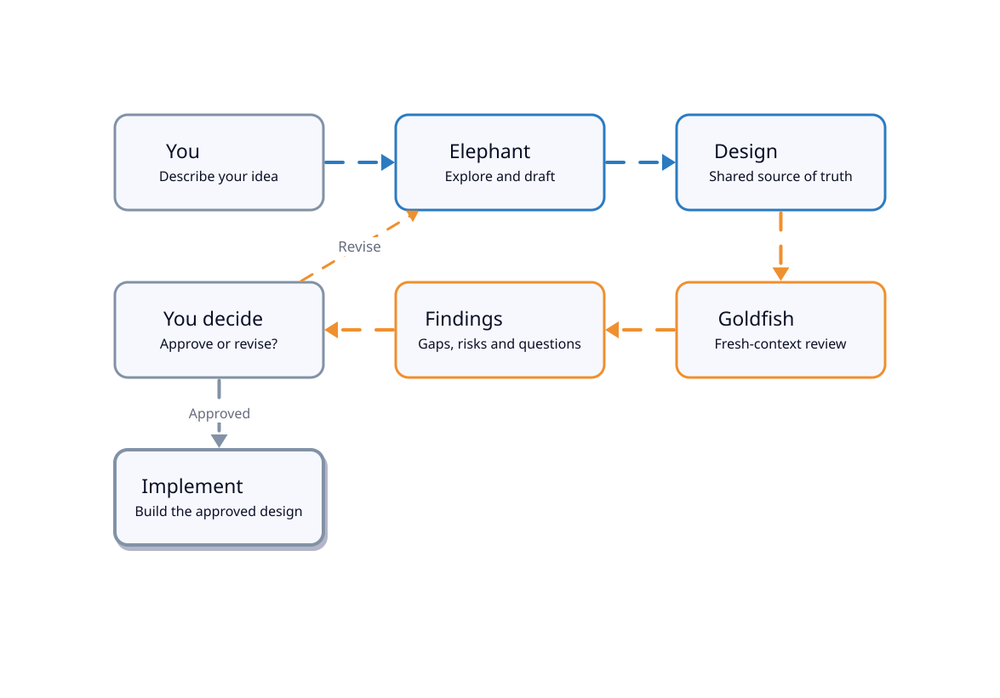

<p align="center">
  
</p>

<h1 align="center">🐘 dsh-egm 🐟</h1>

<p align="center"><a href="README.md">English</a> &ensp;·&ensp; 简体中文</p>

<p align="center">
  <sub>本页为自动翻译，可能存在不准确之处；欢迎提交 PR 修正语法或含义。</sub>
</p>

<p align="center"><strong>用大象做设计。用金鱼做评审。</strong></p>

<p align="center">
  <a href="#安装">安装</a> &ensp;·&ensp;
  <a href="#快速开始">快速开始</a> &ensp;·&ensp;
  <a href="#工作原理">工作原理</a> &ensp;·&ensp;
  <a href="#本插件新增特性">插件特性</a> &ensp;·&ensp;
  <a href="#包含的技能">技能</a> &ensp;·&ensp;
  <a href="#示例运行">示例运行</a> &ensp;·&ensp;
  <a href="#反馈与支持">反馈</a>
</p>

<p align="center">
  <a href="LICENSE"></a>
  <a href="https://github.com/dryw/dsh-egm/actions/workflows/ci.yml"></a>
  <a href="https://dsh-plugin.org/plugins/dryw/dsh-egm"></a>
  <a href="https://www.npmjs.com/package/dsh-egm"></a>
  
</p>

<p align="center"><sub>Google 的 Elephant-Goldfish Model，适配于 DeepSeek Harness。</sub></p>

## 认识大象 🐘

大象是你长期的设计搭档。

它探索你的项目，阅读相关代码，提出问题，并帮助你评估各种备选方案。它会记录你做出的各项决定及其背后的原因。最终，你们共同输出一份设计文档。

但大象存在一个致命问题：**它记住的太多了。**

经过数小时的讨论，即使你没有明确写下来，它也能理解你的意图。如果你问大象这份设计是否合理，它可能会无意识地用之前对话中的背景知识来填补文档中的空白。

这非常危险，因为后续负责实现该设计的开发者并不具备这些背景上下文。

我们需要一个完全没有记忆的角色。

## 认识金鱼 🐟

金鱼每次都从零开始。

它没有参与过你的设计讨论，不知道你为什么选择某种特定的架构，也不知道哪些需求你口头解释过却忘记写进文档。它只接收一份自包含的评审提示词、设计文档以及所需的参考材料。它可以读取和搜索被允许的项目文件，**但绝不会继承大象的对话历史**。

随后，它尝试去理解你写下的内容。

它能搞清楚系统应该如何工作吗？需求是否清晰无歧义？异常和失败情况是否得到妥善处理？各个接口是否能无缝拼合？最重要的是：**没有参与过最初讨论的人，能否仅凭文档正确构建出这个系统？**

当金鱼发现问题时，大象会协助你解决问题。你修改文档，再次发起评审，直到你满意为止。

最终产出的不仅是一份技术规格说明书，更是能够脱离原始对话、长久留存的项目知识资产。

### 为什么要这么做？

AI 编码助手存在三个常见的失败模式：

1. **遗忘（Forget）：** 当对话被压缩或重启时，关键决策容易丢失。
2. **假设（Assume）：** 助手会非常自信地去实现未经任何人真正同意的需求。
3. **盲从（Agree）：** 助手在评审自己起草的设计时，会悄无声息地带入完全相同的未书面化假设。

[Elephant-Goldfish Model](https://github.com/google/elephant-goldfish-model)（EGM）将上下文丰富的架构设计对话与独立、全新上下文的批评审查彻底分离。**`dsh-egm` 以原生插件的形式，将该工作流引入 [DeepSeek Harness](https://github.com/deepseek-ai/deepseek-harness)。**

当新功能、系统迁移或架构调整需要在编写代码前做出决策时，它能发挥巨大作用。而对于小巧、明确的缺陷修复，使用常规编码工作流即可。

## 安装

环境要求：

- **DeepSeek Harness 0.2.x**，需符合包声明的版本范围 `>=0.2.1-rc.5 <0.3.0`。
- **Node.js 22 或 24**（`>=22 <25`；CI 针对 Node 22 与 24 进行测试）。若使用 DSH 0.2.2 alpha 系列，其自身要求 Node 24.9 或更高版本。

将插件安装到你的 Harness profile 中。示例使用 `web`；请替换为你实际使用的 profile：

```bash
dsh plugin --profile web add dsh-egm
```

重启 Harness，然后在 **设置 → 插件** 中确认插件已被启用。

如果是本地开发，也可以直接从本地检出目录安装：

```bash
dsh plugin --profile web add /path/to/dsh-egm
```

## 快速开始

将下方的每个斜杠命令复制并粘贴到 **Harness 聊天框**中。

假设你要为应用添加 Webhook 投递功能。在编写代码之前，你需要回答以下问题：如果投递失败怎么办？如果同一个事件到达了两次怎么办？

**1. 探索想法。**

```text
/egm-brainstorm Add webhook delivery to this application.
```

大象将帮助你探索需求、替代方案与权衡利弊。头脑风暴工作流会引入全新的评审者来挑战这一提案。你和大象共同确定方向，并将其记录在概念简报（concept brief）中。

**2. 起草设计。**

```text
/egm-draft
```

大象将逐节制定规格说明，主动询问你的决策，而不是默默自行填补空白。默认情况下，它会将草稿保存为 DESIGN.md，存放在以功能命名的文件夹中（例如 docs/designs/webhook-delivery/DESIGN.md）。

**3. 让金鱼入场。**

```text
/egm-review docs/designs/webhook-delivery/DESIGN.md
```

具备全新上下文的只读评审者将审查该设计，找出歧义、缺失的契约、失败边界情况以及实现风险。

**4. 解决评审发现的问题。**

```text
/egm-resolve
```

决定哪些批评意见需要处理，修改设计，并根据需要发起再次评审。由你来决定规格说明书何时达到合格标准。

**接下来，编写代码。** 或者更常见的是，让你的 AI 编码助手来编写——这一次，它对构建目标的理解要清晰得多。

你也可以单独调用各个技能；并不强制要求执行完整顺序。

## 工作原理



*大象记住上下文。金鱼从头开始。最后由你掌控。*

大象推动项目对话持续前进。金鱼评审者在没有任何对话历史的前提下阅读已写成的规格说明。由人类决定接受、拒绝或深入调查哪些问题。

结构化的 `/egm-review` 包含五个阶段：**初始视角拉远（Initial Zoom Out）**、**理解力测试（Comprehension）**、**设计批评（Design Critique）**、**中间视角拉远（Intermediate Zoom Out）** 以及 **实现就绪度（Implementation Readiness）**。不同的评审者从不同角度审查设计，其发现将成为待你解决的事项，而不是由 Agent 代替你做出决策。

了解包含可选引导（bootstrap）步骤的完整协议，请参阅[详细协议流程图](diagrams/protocol.svg)。

### 本插件新增特性

Google 的上游项目提供了 EGM 的技能、评审者角色设定（personas）以及设计标准。本软件包则提供了在 DeepSeek Harness 中运行该工作流所需的集成支持：

- **七项原生技能：** 在 Harness 中直接调用 `/egm-brainstorm`、`/egm-draft`、`/egm-review` 以及其他 EGM 命令。
- **全新的评审者会话：** `egm_reviewer` 工具使用 `egm-reviewer` 预设和自包含提示词启动全新的子 Agent，不会派生或继承大象的会话历史记录。
- **宿主强制执行的只读评审：** 评审者预设仅拥有文件读取和搜索工具，不具备文件写入、命令执行、会话读取、用户提问或任务委派工具。插件还会限制工具可见性，并通过评审允许列表进行防护。这是通过 Harness 工具系统强制执行的，而非仅凭文字要求 Model 遵守。
- **可追溯的上游内容：** EGM 技能、角色设定和标准均从锁定的上游提交中原封不动地引入。Harness 专属的指令是在技能注册时动态注入的，而不是直接修改上游文件。

**关于“只读”的含义与界限：** 它能防止金鱼评审者在受支持的 Harness 配置中使用写入、Shell 及其他被禁用的工具。但**这并不意味着评审者无法看到项目文件**：它们可以读取和搜索允许使用的工具所暴露的内容。请勿将评审者预设视为保密隔离边界，并请务必检查向其公开的项目内容。

本集成针对声明的 DSH 版本范围进行了测试；其隔离行为取决于 Harness 对工具限制和子 Agent 派生 API 的具体实现。 [验证指南](VERIFICATION.md) 详细介绍了防护层、测试及其局限性。 [ADAPTATIONS.md](ADAPTATIONS.md) 解释了哪些内容源自 Google，哪些是本软件包新增的内容。

## 包含的技能

| 技能 | 调用方式 | 用途… |
|---|---|---|
| Brainstorm | `/egm-brainstorm` | 探索提案，挑战假设，并生成概念简报。 |
| Draft | `/egm-draft` | 将简报或现有笔记转化为设计文档。 |
| Review | `/egm-review` | 使用全新上下文的金鱼 Agent 分五个阶段评审设计。 |
| Resolve | `/egm-resolve` | 归类发现的问题，并就设计修改达成一致。 |
| Review loop | `/egm-review-loop` | 针对特定评审任务运行配置好的评审者组合。 |
| Bootstrap | `/egm-bootstrap` | 为现有项目构建 README 与代码库上下文。 |
| Drift report | `/egm-drift-report` | 将已签入的设计文档与当前源代码进行对比。 |

全部七项技能均由**用户手动调用**。插件不会自动启动高开销的设计或评审流程，也不会在设计完成评审后自动开始实现代码。

### 文档保存在哪里？

EGM 使用普通的 Markdown 文件。典型项目的规范存储结构如下：

```text
my-project/
├── AGENTS.md
└── docs/
    └── designs/
        └── webhook-delivery/
            └── DESIGN.md
```

产物的保存位置取决于具体技能和项目配置。若要将 EGM 的工作临时产物定向到独立目录，请在项目的 `AGENTS.md` 中添加以下内容：

```text
EGM artifact directory: .dev/docs
```

你可以将该工作目录加入 `.gitignore`，同时将最终确定的设计文档纳入版本控制。这样在原始对话结束很久之后，各种决策、评审记录和实现计划依然清晰可查。

## 示例运行

想看看评审者是否真的能发现有价值的问题？

仓库中包含一份针对小型库存应用的[端到端完整记录示例](examples/e2e-verification/)。其中包含概念简报、设计文档以及全部五个阶段的评审报告。

在其中一次评审中，金鱼捕获了一个重要的接口缺失：拟议的库存清理（inventory sweep）需要锁来覆盖一连串的操作，但设计说明书中从未指定清理程序获取该锁的安全方式。修改后的设计引入了一个加锁的快照上下文管理器（locked snapshot context manager），而不是直接伸进库存存储的私有锁中。参见[问题发现与解决方案](examples/e2e-verification/reviews/zoom_out_report.md)。

该次运行使用了合成的所有者答复、自动批准了部分草稿阶段，并将评审拆分到受支持的预设上执行；其最终实现就绪度复审在复审上限处返回 **NO-GO**，剩余的精确性问题已记录并在之后的设计中修复。它展示了设计工作流及其发现具体问题的能力，**并不**表示示例功能已经实现，也不表示最终设计通过了所有关卡。该示例是 `0.2.0` 的历史证据。

有关运行环境、评审者激活、产物与让步（concessions），请参阅 [E2E-VERIFICATION.md](E2E-VERIFICATION.md)。示例文件仅存在于 GitHub 仓库中，不包含在 npm 包内。

## 反馈与支持

首次尝试使用 `dsh-egm`？无论运行成功与否，你的体验反馈都非常有价值。

- **安装失败或遇到 Bug？** [提交 Bug 报告](https://github.com/dryw/dsh-egm/issues/new?template=bug_report.yml)。请附上执行的命令、出现的异常行为，以及你的 DSH 和 Node 版本信息。
- **有改进建议或文档想法？** [提交功能需求](https://github.com/dryw/dsh-egm/issues/new?template=feature_request.yml)。
- **想分享首次使用体验或提问？** [新建 Issue](https://github.com/dryw/dsh-egm/issues/new/choose)。

我特别想了解插件是否安装顺畅、金鱼评审者是否如预期启动，以及它们的批评意见是否对你的设计产生了实质帮助。

**在分享日志或示例前：** 请务必抹去 API 密钥、凭据、个人信息以及敏感的项目内容。提供经过脱敏的小型复现示例比提供完整的私有对话记录更好。

## 供维护者与好奇者阅读

- [VERIFICATION.md](VERIFICATION.md) — 评审者隔离、可复现测试、CI 和验证证据。
- [E2E-VERIFICATION.md](E2E-VERIFICATION.md) — 记录的设计工作流及其局限性。
- [ADAPTATIONS.md](ADAPTATIONS.md) 与 [ADAPTER-NOTES.md](ADAPTER-NOTES.md) — 上游来源与 Harness 专属机制说明。
- [CHANGELOG.md](CHANGELOG.md) — 版本变更历史。
- [diagrams/](diagrams/README.md) — 工作流架构图及其源码。

如需在检出目录中运行软件包检查：

```bash
node --test
node scripts/check-upstream.mjs
```

上游漂移检查仅报告变化，绝不会修改或替换内置文件。

## 许可证与署名

本项目基于 [Apache License, Version 2.0](LICENSE) 开源。

技能、评审者角色设定、标准和模板均随包内置，源自 [google/elephant-goldfish-model](https://github.com/google/elephant-goldfish-model)，Copyright Google LLC，采用 Apache-2.0 授权；参见 [NOTICE](NOTICE) 与 [ADAPTATIONS.md](ADAPTATIONS.md)。DeepSeek Harness 适配器、插件包以及评审者预设均为本软件包的原创工作。

`dsh-egm` 是一个独立的社区移植版本。它与 Google 无任何隶属关系，亦未获得 Google 的认可或官方支持。